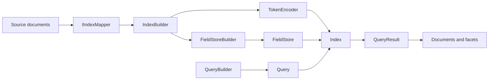

# Clara Architecture

## Operating model

An index is a set of in-memory structures ready for reading, built for specific field instances. It does not support individual document updates, saving the index to disk, or loading it from a file. Changing the data requires building a new index. The library is intended for relatively small collections; practical limits depend on vocabulary size, the number of field values, and process memory.

`IndexBuilder` performs the expensive preparation: analyzing text, building token-to-document relationships, computing scores, and sorting values for range filters. `Index.Query` works primarily with integer identifiers and document sets. Domain objects are retrieved from the document map when results are read.

## Responsibilities

| Area | Responsibility and key types |
| --- | --- |
| `src/Clara/` | Public entry points: `IndexBuilder`, `Index<TDocument>` |
| `Mapping/` | The `IIndexMapper` contract, field definitions, `TextWeight`, `Similarity`, `ScoreAggregation` |
| `Analysis/` | `IAnalyzer`, `ITokenizer`, filters, tokens, positions, and synonyms |
| `Storage/` | Building and reading index structures, performing set operations |
| `Querying/` | The builder, expressions, and typed result collections |
| `Utils/` | `*Slim` collections, helper operations, and object pools |
| `SharedObjectPools.cs` | Shared pools for temporary query structures |

`FieldStore` classes and their builders are internal. The public `Field` type has an internal constructor and store factory, so an entirely new field kind requires a change to the core library. Text analysis and scoring extensions can use public interfaces and base classes.

## Projects and dependencies

The `Clara` core does not depend on the language projects. `Clara.Analysis.Snowball`, `Clara.Analysis.Morfologik`, and `Clara.Analysis.LuceneNet` reference the core. Tests and benchmarks use all four libraries.

- **Snowball** contains stemming algorithms, filter adapters, analyzers, and embedded stopword lists.
- **Morfologik** uses `Morfologik.Polish` for Polish language analysis.
- **LuceneNet** provides adapters and a reference implementation for tests and benchmarks. Its project sets `IsPackable=false`.
- **Tests** contains xUnit tests and an embedded product dataset.
- **Benchmarks** is a BenchmarkDotNet console application.

Many analyzers from different assemblies use the `Clara.Analysis` namespace. A type's namespace does not uniquely identify the package that must be referenced.

## Boundaries and invariants

1. A document key must be unique within the index being built.
2. A query field must be the same instance used to build the index.
3. A `Query` belongs to a specific index and cannot run against a replacement index after a rebuild.
4. A synonym map and its text field must share the same analyzer instance.
5. Results and temporary buffers have bounded lifetimes; their owner returns them to the pool through `Dispose()`.

## Source reading guide

Start with [IndexBuilder.cs](../src/Clara/IndexBuilder.cs), then read [Index.cs](../src/Clara/Index.cs). [TextFieldStoreBuilder.cs](../src/Clara/Storage/TextFieldStoreBuilder.cs) and [TextDocumentStore.cs](../src/Clara/Storage/TextDocumentStore.cs) illustrate the separation between building and reading. [DocumentResultBuilder.cs](../src/Clara/Storage/DocumentResultBuilder.cs) explains facet semantics.
