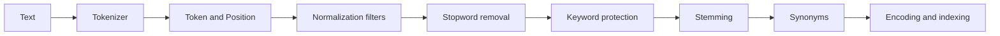

# Text Analysis and Synonyms

## Token flow

`IAnalyzer` exposes a tokenizer and a `CreateTokenTermSource()` factory. The resulting source provides `GetTerms(text)`, which returns a sequence of `TokenTerm` values: a token and its position. [`Analyzer`](../src/Clara/Analysis/Analyzer.cs) combines a tokenizer with an ordered `ITokenFilter` chain.



This is an example order for language analyzers. `StandardAnalyzer` only lowercases text and optionally applies a stopword list. It removes no words by default. `PorterAnalyzer` also removes English possessive suffixes and uses a default stopword list and the Porter stemmer.

## Tokenization and token lifetime

[`StandardTokenizer`](../src/Clara/Analysis/StandardTokenizer.cs) recognizes letters, digits, and underscores. It has special rules for apostrophes between letters, some dotted abbreviations, and dots or commas between digits. Tokens containing only underscores are skipped. `WhitespaceTokenizer` splits only on whitespace. Do not assume the standard tokenizer parses identifiers or URLs.

`Token.MaximumLength` is 255 `char` units. Both tokenizers skip tokens exceeding this limit rather than truncating them. `Position` is a token number or range of token numbers, not a character offset. Standard sources use zero-based positions.

[`Token`](../src/Clara/Analysis/Token.cs) is a struct that can refer to an immutable `string` or a shared character array. Copying the struct does not copy the buffer. Token sources are stateful and reuse the same enumerator and buffer. Process one text at a time and copy values during enumeration:

```csharp
var source = new StandardAnalyzer().CreateTokenTermSource();
var values = source.GetTerms("Red MUG")
    .Select(term => term.Token.ToString())
    .ToArray();
// values: ["red", "mug"]
```

Storing `TokenTerm` values directly in a list may retain references to an overwritten buffer. Do not share one source between concurrent or nested enumerations.

## Filter contract

`ITokenFilter.Process(Token token, TokenFilterDelegate next)` can modify a token, pass it onward, discard it by returning an empty token, or terminate the chain. Filters execute in the order supplied to the `Analyzer` constructor, even though the delegates are assembled in reverse order.

- `LowerInvariantTokenFilter` normalizes letter case.
- `StopTokenFilter` discards specified words.
- `KeywordTokenFilter` returns a matching token without calling `next`, protecting it from further changes.
- Length and digit filters have variants that discard or protect a token.
- The Porter stemmer, Snowball filters, and Morfologik filters terminate processing by returning the token; place them at the end of the chain.

Stopword and keyword lists should match the token's form at the stage where the filter runs. Use lowercase entries when normalization precedes the filter. Passing `null` for stopwords in language analyzers selects the built-in list; an empty collection disables it.

When adding a custom filter, explicitly decide when to call `next(token)`. A token backed by a `string` is read-only; mutation requires a writable buffer.

## Language analyzers

| Project | Mechanism |
| --- | --- |
| `Clara` | `StandardAnalyzer` and the English `PorterAnalyzer` |
| `Clara.Analysis.Snowball` | Language analyzers, including `EnglishAnalyzer` and `PolishAnalyzer`, using Snowball algorithms |
| `Clara.Analysis.Morfologik` | `MorfologikAnalyzer`, backed by a Polish dictionary |
| `Clara.Analysis.LuceneNet` | Lucene adapters used for purposes including test comparisons |

Snowball includes algorithms under `Snowball/Algorithms` and public analyzers under `Analysis/`. An algorithm file alone does not imply a public analyzer exists. The generated Snowball directory has a local `.editorconfig`; preserve code provenance when updating it.

Morfologik emits one selected lemma rather than every possible interpretation. The filter traverses dictionary results in reverse and prefers the first valid lemma it encounters that ends in `y`; otherwise, it retains the last valid lemma assigned. If there are no matches, the input token remains unchanged. Source: [MorfologikStemTokenFilter.cs](../src/Clara.Analysis.Morfologik/Analysis/MorfologikStemTokenFilter.cs).

## Synonyms

`SynonymMap` is in `Clara.Analysis.Synonyms`; `Synonym`, `EquivalencySynonym`, and `ExplicitMappingSynonym` are in `Clara.Analysis`. The map normalizes rules with the same analyzer used for documents. The text field checks analyzer instance identity.

```csharp
var analyzer = new StandardAnalyzer();
var rules = Synonym.Parse("mug, cup\ni phone, i-phone => iphone");
var synonyms = new SynonymMap(analyzer, rules);
var text = new TextField<Product>(x => x.Title, analyzer, synonyms);
```

`EquivalencySynonym` defines an equivalence group. With the default `expand=true`, an indexed occurrence expands into the group's representations. With `expand=false`, the target is the group's first analyzed phrase. `ExplicitMappingSynonym` maps the left side to the right side; the source is not automatically retained unless it is also included among the targets.

The parser supports comma-separated phrases, `=>`, blank lines, and comments beginning with `#`. Invalid lines can be skipped, so compare the number and content of parsed rules with expectations when accepting external configuration.

### Two uses of the map

During indexing, `CreateTokenTermSource()` emits replacement tokens. `TextWeight.ExpandSynonyms=false` selects the analyzer alone for a value. During search, `CreatePhraseTermSource()` retains the phrase groups needed to interpret mappings. The map uses a token tree; when a longer match fails, it backtracks to an available shorter replacement and replays the remaining tokens.

Search phrases combine tokens with AND; alternatives use OR and the maximum score. This does not preserve token positions within the document. Disabling expansion for an indexed value also does not disable the map on the query side. Check both sides of nontrivial rules using [SynonymMapTests.cs](../src/Clara.Tests/SynonymMapTests.cs).
